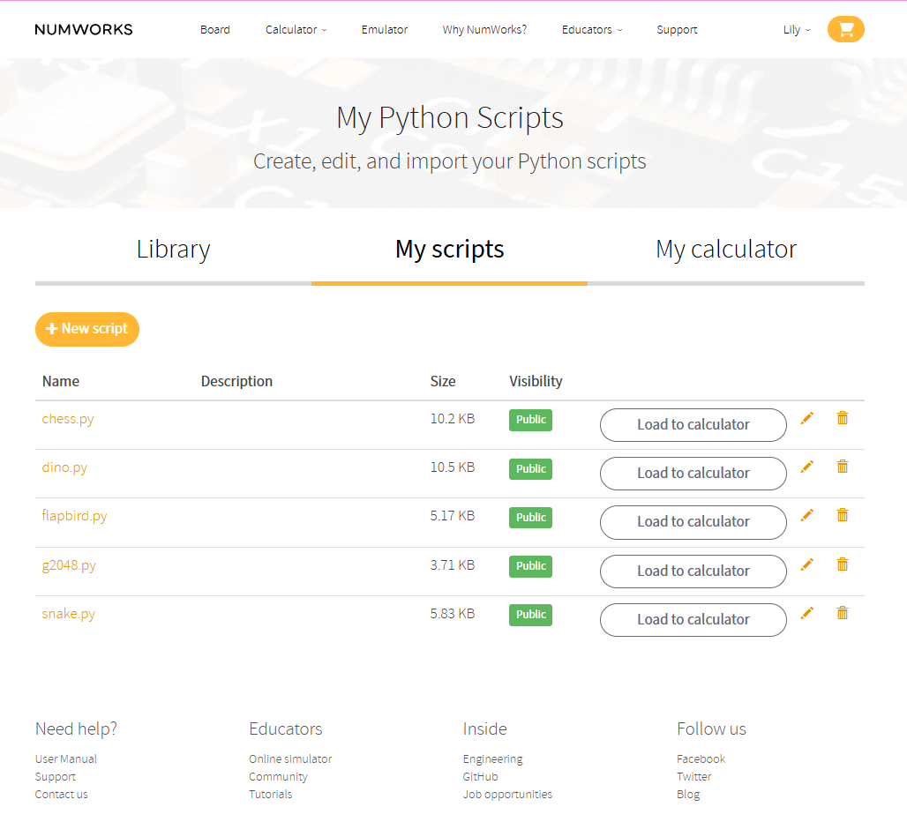

# Lily's Small NumWorks Games

A collection of small, optimized Python games made to run on the NumWorks graphing calculator.

Each game is compressed to use as little storage space as possible while remaining fully playable.

## Available Games

| Games | File Size |
|---|---:|
| Chess | 10,402 bytes |
| Chrome Dino | 10,760 bytes |
| Snake | 5,953 bytes |
| Flappy Bird | 5,279 bytes |
| 2048 | 3,785 bytes |

# how to upload the games on the calculator:
#### to use these games you need to go on  "https://my.numworks.com/python/calculator"

when on the website after making an account go in "My Scripts" and press new script

## copy the code from the game that you want into the websites code editor

## after doing this you can unplug your calculator
to lanch a game go in python -> game.py click the three dots and click "execute program"

## enjoy!!!
